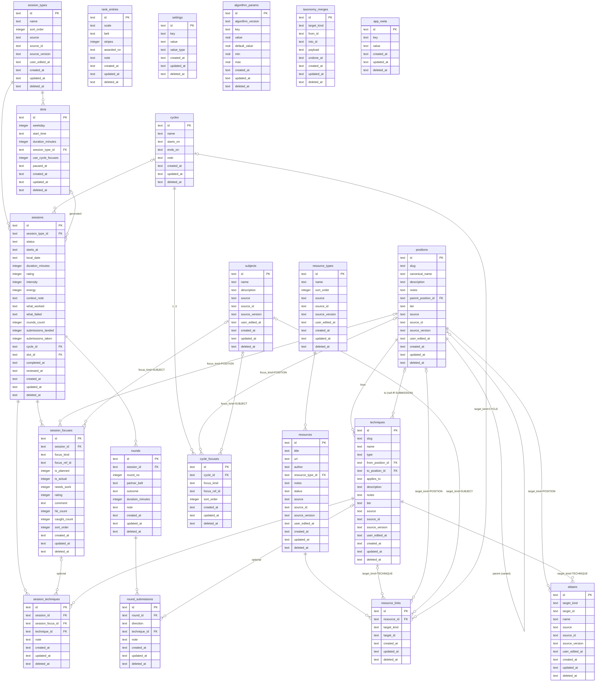

# matIQ — product specification

Derived from `docs/product-spec/po-brief.md` (PO rulings S-01…S-12, R-00…R-35, 2026-10-31) and `docs/decisions.md`. Plan: `docs/product-spec/plan.md`. Items the brief leaves open are marked "pending ruling (plan §0.1 #n)" and carry the plan's default until the PO rules.

## §1 What matIQ is

A personal deliberate-practice companion for a Brazilian jiu-jitsu practitioner. In the PO's words (S-12): "an application that can track BJJ progress and help people to progess their skills … plan, log, have a retrospective on a trainings sessions … an algorithm that checks whether their progression in a certain area of bjj they want to work on, or lack skill. All these things should be able to be altered by the user". The loop — plan what to work on → train → log what actually happened → review → see where you are improving and where you are lacking — must be fast enough to run mat-side and honest enough to trust (R-01). Native iOS and Android (Expo / React Native, S-01), all data on the device (S-02), one practitioner in v1 built so publishing needs no rework (S-03). App name matIQ, bundle id / package `nl.btnt.matiq`, scheme `matiq` (S-09).

## §2 Glossary

| term | meaning |
|---|---|
| **Focus** | The unit that is planned, logged and scored: a position node of the graph or a subject (R-04, R-30 provisional). Stored as `{kind, ref_id}`; techniques become a third kind in v1.x. |
| **Position** | A node of the technique graph (e.g. closed guard, side control); may have a parent (variant). Has one canonical name and any number of aliases (R-23, R-34). |
| **Technique** | A typed edge from a position to a position: transition, guard pass, sweep, escape, takedown, or submission; a submission is terminal (no target). |
| **Alias** | An alternative name for a position (or technique, pending ruling plan §0.1 #3); search matches any alias; the Library shows the canonical name with aliases beneath (R-34). |
| **Subject** | A cross-cutting theme used as a focus (grip fighting, guard retention); user-editable, seeded (pending ruling plan §0.1 #4). |
| **Session** | One training occasion with a type (Gi class, Open mat, … — user-editable, R-03), a status (planned, completed, skipped) and signals. |
| **Planned vs actual** | A focus row on a session carries `is_planned` (intended before training) and `is_actual` (trained). Planned-but-not-actual feeds the gap signal; a session completes only with at least one actual focus. |
| **Needs work** (flag) | The user's own mark on an actual focus row; shown as **Flagged**; feeds suggestions and the algorithm but is never itself the computed state (R-17). |
| **Needs work** (state) | One of the four computed progression states (R-17). |
| **Hit / caught** | Optional counts per focus: times the focus worked for you / times you got caught in it (R-05). |
| **Round** | One sparring round, optionally logged in detail (partner belt, outcome, submissions landed/taken, note); zero, one or more per session; aggregates (rounds, submissions) always exist on the session (R-06, R-19). |
| **Cycle** | A 1–3-focus block with start and end dates, default four weeks (R-07); feeds planning suggestions and slot defaults. |
| **Slot** | A recurring weekly training moment (weekday, time, session type) that generates planned sessions two weeks ahead (R-20). |
| **Suggestion** | A focus proposed when planning, from one of four sources the user can switch off (R-09, R-21). |
| **Resource** | An instructional, video, article or other reference with a URL, author, notes and a to-watch/watched status, attachable to a technique, a focus or a cycle (R-29). |
| **Progression states** | **Improving · Steady · Needs work · Not trained lately**, computed per focus over a rolling window, each with an explanation (R-08, R-17). |
| **Rank** | Belt + stripes with promotion dates (history); adult or kids scale (R-10). |
| **Core / extended library** | The curated subset of the graph shown by default vs the full converted graph behind a setting (R-28). |
| **Taxonomy release** | A versioned seed of positions, techniques, aliases and resources shipped with the app (R-28). |

## §3 User and scope

- **v1 user:** the PO, one practitioner, iPhone first (S-03 "Me first, built for publishing"; S-08 iOS-first, Android via EAS Build).
- **Publishable later:** export, import and erase ship in v1 (R-12); encryption at rest from the start (R-24); no analytics or crash SDK without an ADR (`.claude/rules/privacy.md`).
- **v2 direction:** a coach tier with backend and accounts so a coach follows clients as a paid tier (R-27 "Ideally i can monitize this app for coaches to check in on their clients"). v1 keeps the sync seam, versions the JSON export as the future upload format, and assumes nothing about a single user forever.
- **Way of working:** `develop` default / `main` released, PRs only (S-10, ADR 0001); the sugar/cadence agent harness (S-11, ADR 0002); sprint order per R-32 (`docs/product-spec/plan.md §7`).
- **Non-goals v1:** coach, club, sharing, social, accounts, sync, cloud backup; strength & conditioning modelling (R-03); per-partner analytics; hosting or embedding video; scraping instructional sites (R-33); a web app (S-04); Android local E2E until an SDK exists; BJJGraph import without a licence (R-28). Gym check-in/schedule, coach badge/notes and the instructional-video area from the design artifact stay out (R-16).

## §4 Core loop and screens

1. **Plan** — a planned session (date, type, planned focuses) by hand, from a slot (R-20) or from suggestions (R-09); optionally inside a cycle (R-07).
2. **Train.**
3. **Log** — Log Session: type, actual focuses (planned ones pre-ticked), per-focus rating / flag / comment / counts, optional techniques, round aggregates, optional detailed rounds, session rating / duration / intensity / energy / context note, what worked / what failed. The ≤ 30 s path: type, focuses, per-focus rating, done (R-26).
4. **Review** — the same screen in review mode; needs-work flags feed suggestions (R-26).
5. **Progress** — state per focus with "why", window and weights editable, rank history.

Screens (R-02, exactly): **Home** · **Log Session** · **Library** · **Technique detail** · **Progress** · **Settings**, plus the planning flow. Anything else is v1.x.

## §5 Domain model

Every table carries the sync seam: `id` text PK (UUID v4), `created_at`, `updated_at` (ISO-8601 UTC), `deleted_at` nullable; no hard delete; every read filters `deleted_at IS NULL` (`.claude/rules/data.md`). Imported tables (`positions`, `techniques`, `aliases`, `subjects`, `resources`, `session_types`, `resource_types`) add `source`, `source_id`, `source_version`, `user_edited_at` (R-23). A focus is `{focus_kind, focus_ref_id}` with `focus_kind ∈ POSITION | SUBJECT | TECHNIQUE`; `TECHNIQUE` is rejected by the domain in v1 (R-30, **provisional**). Field-level detail, checks and belt lists: `docs/product-spec/plan.md §4`.

Invariants carried from the legacy prototype and the brief: `needs_work ⇒ is_actual`; `rating ⇒ is_actual`; ratings 1–5; `to_position_id` null iff `type = SUBMISSION`; a session completes only with ≥ 1 actual focus row; focus rows unique per (session, kind, ref); cycle 1–3 focuses; weekday 1–7 with Monday = 1 (R-15). Reviews are columns on `sessions` (one review per session, same screen, R-26). Seed rows keep ids fixed in the seed file across taxonomy releases (R-28 "our own stable ids").

## §6 Features by screen

Visual source for every screen: the PO's Claude Artifact exported to `design-system/artifact/`, tokens extracted by the designer (S-05); the open design requests (DSR-17…25, brief §12) must be designed before the sprint that uses them.

**Home** — today's plan and next planned session (from slots or by hand); quick log (≤ 2 taps to a prefilled Log Session, R-26); suggestions with their source label (R-09); current rank (R-10); unlogged recent sessions as a nudge; empty state explains the first step.

**Log Session** — type (required, prefilled); focuses (≥ 1 required; planned pre-ticked; search across names and aliases, R-34); per focus: rating 1–5, needs-work flag, comment, hit/caught counts (R-05); optional techniques attached to a focus (R-04); round aggregates (rounds, submissions landed/taken); detailed rounds when `log.detailedRounds` is on: partner belt, outcome (pending ruling plan §0.1 #1), submissions tied to a technique, note (R-19); session: duration (minutes), rating, intensity, energy, context note, what worked / what failed (R-05, R-15). Review mode = same screen (R-26). Delete = soft delete with undo toast.

**Library** — positions (nodes) with canonical name and aliases, techniques (edges) grouped by type, subjects; core shown by default, extended behind `library.showExtended` (R-28); search by any alias (R-34). Sprint 1 read-only; sprint 2 editing: add, rename (follows the id everywhere), soft delete (hidden from pickers, history kept), merge (history moves to the survivor; undoable), alias add/remove (R-14, R-23). User edits are never overwritten by a taxonomy release (R-23). Technique aliases: pending ruling (plan §0.1 #3).

**Technique detail** — type, from/to positions, gi/no-gi applicability, description (imported) and notes (user), resources attached (R-29) with to-watch/watched status, history of sessions where it was attached; v1.x adds technique-level progression (R-04).

**Progress** — per focus: state (Improving · Steady · Needs work · Not trained lately) with a "why" sheet listing each signal's value, weight and threshold (R-08, R-17); Flagged badge separate; window and weights editable with reset (R-08); rank history (R-10); consistency heatmap and planned-vs-actual gaps (brief §6 dashboards) as secondary panels. Graph visualisation with progression overlay = later (R-23).

**Settings** — rank (belt, stripes, promotion dates; kids scale toggle, R-10); algorithm weights, thresholds, window with "reset to defaults" and the active `algorithm.version` (R-08, R-22); suggestion sources (four switches) and maximum (R-21); detailed-rounds toggle (R-19); recurring slots (R-20); reminders (R-11); theme follows system with override (DSR-21); session types and resource types editing (R-03, R-29); export JSON, import JSON, erase all (R-12; erase confirmation pending ruling plan §0.1 #2); about and licences (GrappleMap public domain, grapple-flows CC BY 4.0 attribution — required by the licence, R-28); app lock later (R-25).

**Planning flow** — create a planned session (date, type, focuses from suggestions or search); create or end a cycle (1–3 focuses, default four weeks; one active at a time, pending ruling plan §0.1 #5); manage slots (R-07, R-20).

## §7 Progression algorithm v1

Ruled shape (R-08 "Yes Deterministic, but in the future the algo might be changed or tweaked"; S-06): deterministic, pure TypeScript in `mobile/src/domain/progression/v1`, computed when Progress opens or a session is reviewed, no background jobs.

- **Inputs per focus** over the window (`windowWeeks`, default 8, editable): trend of per-focus ratings; needs-work frequency; planned-vs-actual gap; days since last trained; hit/caught ratio when logged.
- **States** (R-17): Improving · Steady · Needs work · Not trained lately. "Flagged" is the user's own needs-work mark on the last completed session, never a computed state.
- **Rules, first match wins** (planner's defaults, tuned once real data exists): (1) no actual session in window or `daysSince > staleDays` (21) → Not trained lately; (2) weighted needs-work score ≥ `needsWorkThreshold` (0.5) → Needs work, with weights `wNeedsWork` 0.4, `wHitCaught` 0.25, `wGap` 0.2, `wTrend` 0.15; (3) `trend ≥ trendImproving` (0.5 on the 1–5 scale) with ≥ `minSessions` (3) → Improving; (4) else Steady. Signals without enough data are omitted and their weight redistributed; the explanation says so.
- **Explanation**: every state shows each signal's value, weight and the threshold it crossed, and which rule fired (R-08 "every state explains why").
- **Configuration**: weights, thresholds and window are `algorithm_params` rows with `default_value` and bounds; "reset to defaults" in Settings (R-08); the domain reads them as inputs, never as constants (`.claude/rules/data.md`).
- **Versioning** (R-22): rows carry `algorithm_version`; `settings.algorithm.version` names the one active version; a v2 ships as a new module with new default rows and a one-time carry-over/reset notice.
- **Suggestions** (R-09, R-21): sources = last session's needs-work flags · active cycle focuses · focuses in state Needs work · focuses in state Not trained lately; each switchable; at most `suggest.max` (3); accept or ignore.

## §8 Taxonomy

- **Graph** (R-23): positions are nodes (with a parent/variant relation), techniques are typed edges (TRANSITION, GUARD_PASS, SWEEP, ESCAPE, TAKEDOWN, SUBMISSION; submissions terminal), aliases are first-class and searchable (R-34). v1 stores no layout data; nodes, edges and progression per node stay queryable for the later graph view.
- **Sources** (R-13, R-28 "ok do that"): GrappleMap (public domain; 601 positions, 1485 transitions, 1208 `ref:` citations) converted by our own TypeScript parser into nodes and typed edges under our own stable ids; canonical names and aliases hand-curated starting from grapple-flows/bjj-data (CC BY 4.0, attribution shown in Settings); edge types derived from tags then reviewed; gi techniques hand-authored in our layer (`applies_to`); BJJGraph structural reference only unless the PO obtains a licence. GrappleMap's citations seed Resources (R-33).
- **Pipeline** (R-35): `scripts/taxonomy/` vendors the GrappleMap snapshot one file per record (PR 5 format), validates it (PR 4 rules), parses per PR 6's format description, canonicalises poses to resolve endpoints, cleans names, derives edge types, applies the hand-maintained curated-core list and emits a seed JSON with a release version. Reimplemented, not copied.
- **Core + extended** (R-28): ≈ 40–60 positions and ≈ 150 techniques are `CORE` and visible by default; the rest is `EXTENDED` behind a setting.
- **User layer wins on re-import** (R-23): a release upserts only rows whose `user_edited_at` and `deleted_at` are null; user-authored rows (`source IS NULL`) are never touched; the seed never hard-deletes.
- **Editing semantics** (R-14): rename follows the id everywhere (old name kept as alias by default); delete is soft and hides the row from pickers while history keeps rendering it; merge moves every reference (focus rows, cycle focuses, resource links, aliases, edges) to the survivor, hides the other and is undoable from its merge log.

## §9 Data, privacy, publishing readiness

- **On device only** (`.claude/rules/privacy.md`; S-02): no backend, no account, no sync, no network call carrying user data; the only outbound action is opening a Resource URL in the browser (R-29).
- **Encryption at rest** (R-24): SQLCipher through `expo-sqlite`'s `useSQLCipher`; key generated on first launch, kept in Keychain/Keystore via `expo-secure-store`; development, smoke checks and Maestro on dev-client builds only (R-31); Jest on plain better-sqlite3.
- **Export / import / erase** (R-12): JSON export of every table including tombstones, versioned (`export_schema_version`) and documented as the future upload format (R-27); import merges by id with the newest `updated_at` winning; erase wipes all tables, rotates the key and reseeds. Both ship before any store release.
- **No analytics, crash-reporting or advertising SDK** without a dated ruling and an ADR; no third-party identifiers.
- **App lock** (R-25): optional biometric/passcode on open, v1.x.
- **Fixtures and screenshots** use fictional data only.

## §10 Non-functional requirements

UX acceptance criteria (R-00, R-26 "yes", R-18 "yes"), each testable and in both reviewer checklists:

| id | requirement | test |
|---|---|---|
| NF-01 | From Home, the Log Session screen with type and focuses prefilled is reached in ≤ 2 taps; saving with only the required fields takes one further tap | Maestro flow counts taps by testID |
| NF-02 | The log path type → focuses → per-focus rating → done completes in ≤ 30 s | timed Maestro flow on the simulator |
| NF-03 | Only session type and one focus are required; every other field optional | domain test: `sessions.log` with two fields succeeds |
| NF-04 | Every screen usable one-handed in portrait at 390 and 430 px; primary action bottom-anchored | design review + Maestro at both widths |
| NF-05 | Destructive actions are soft deletes with an undo toast, no confirm dialog (exception: erase all, pending ruling plan §0.1 #2) | Maestro: delete → undo restores |
| NF-06 | Every empty state names the next step | copy table in design.md; Maestro assertVisible |
| NF-07 | Readable in light and dark; tokens only; theme override in Settings | token adherence check; dark-mode screenshots |
| NF-08 | Hit targets ≥ 44 pt iOS / 48 dp Android, smaller elements extended with `hitSlop` | design review |
| NF-09 | Progression for all focuses over the window computes in < 100 ms on device for 500 sessions | domain benchmark test |
| NF-10 | Fully offline: no feature depends on connectivity | review |
| NF-11 | Every user-facing string via i18n keys; English only (S-07) | lint/test |
| NF-12 | Every interactive element and list row carries a `testID` `<screen>.<element>[.<id>]` | Maestro flows select by `id:` |
| NF-13 | Duration in minutes; dates and times in device locale and zone; weeks start Monday; no unit conversion (R-15) | unit tests on formatting |

## §11 Later

Order of work (R-32 "ok"): sprint 1 foundation → sprint 2 Progress, Settings, Library editing, Technique detail → sprint 3 cycles, slots, reminders, export/import/erase, detailed rounds → v1.x → v2.

- **v1.x:** technique-level progression (first; R-04), app lock (R-25), graph visualisation with progression overlay (R-23), resources watch list (R-29), legacy data import for the PO (pending ruling plan §0.1 #6).
- **v2:** coach tier with backend and accounts (R-27, ADR + CO-08), instructional import from public catalogues subject to terms of service (R-33), strength & conditioning session family (R-03), BJJGraph data if licensed (R-28).

## §12 Rulings register

| id | section(s) | id | section(s) |
|---|---|---|---|
| S-01 | §1, §3 | R-12 | §3, §6 Settings, §9 |
| S-02 | §1, §9 | R-13 | §8 |
| S-03 | §1, §3 | R-14 | §6 Library, §8 |
| S-04 | §3, §10 | R-15 | §5, §6 Log, §10 NF-13 |
| S-05 | §6 (design artifact source; DSR references) | R-16 | §3 |
| S-06 | §7 | R-17 | §2, §6 Progress, §7 |
| S-07 | §10 NF-11 | R-18 | §10 NF-08 |
| S-08 | §3 | R-19 | §2, §6 Log, §6 Settings |
| S-09 | §1 (bundle `nl.btnt.matiq`, scheme `matiq`) | R-20 | §2, §4, §6 Settings, §6 Planning |
| S-10 | §3 | R-21 | §6 Settings, §7 |
| S-11 | §3 | R-22 | §6 Settings, §7 |
| S-12 | §1 | R-23 | §2, §5, §6 Library, §8, §11 |
| R-00 | §10 | R-24 | §3, §9 |
| R-01 | §1 | R-25 | §6 Settings, §9, §11 |
| R-02 | §4 | R-26 | §4, §5, §6, §10 |
| R-03 | §2, §3, §6 Settings, §11 | R-27 | §3, §9, §11 |
| R-04 | §2, §6 Log, §6 Technique, §11 | R-28 | §2, §5, §6 Library, §6 Settings, §8, §11 |
| R-05 | §2, §6 Log | R-29 | §2, §6 Technique, §6 Settings, §9, §11 |
| R-06 | §2, §6 Log | R-30 | §2, §5 (provisional) |
| R-07 | §2, §4, §6 Planning | R-31 | §9 |
| R-08 | §2, §6 Progress, §6 Settings, §7 | R-32 | §3, §11 |
| R-09 | §2, §4, §6 Home, §7 | R-33 | §3, §8, §11 |
| R-10 | §2, §6 Home, §6 Progress, §6 Settings | R-34 | §2, §6 Log, §6 Library, §8 |
| R-11 | §6 Settings | R-35 | §8 |

Every id also has a dated bullet in `docs/decisions.md`.
