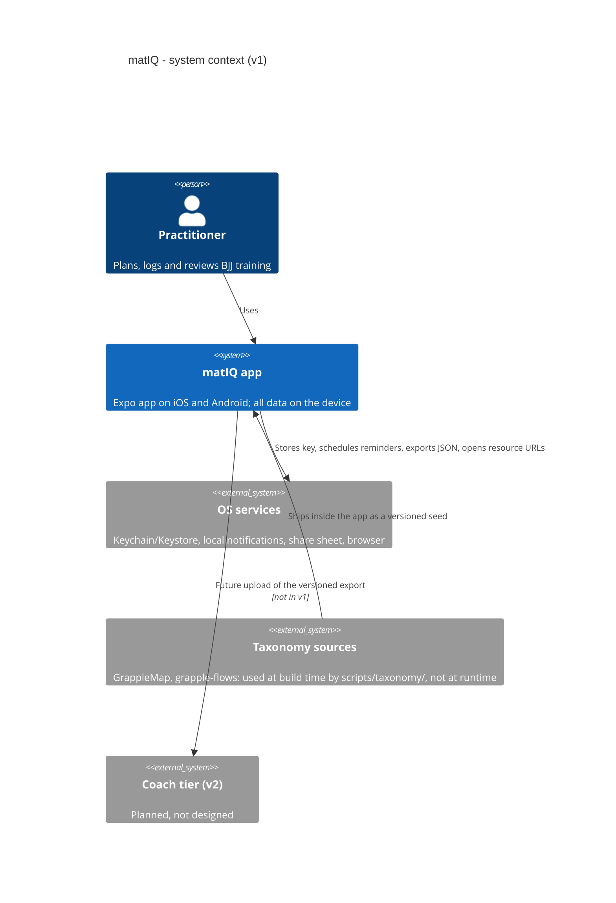

# 03. Context and scope

## Scope

| In (v1) | Out (v1) |
|---|---|
| Home, Log Session, Library, Technique detail, Progress, Settings, planning flow (R-02) | Coach, club, sharing, social, accounts, sync, cloud backup |
| Local reminders (sprint 3), JSON export/import/erase | Gym check-in, coach notes, video area (R-16), scraping of instructional sites (R-33) |
| Opening a resource URL in the browser (the only outbound action) | S&C modelling (R-03), web app (S-04) |

## External interfaces

| Interface | Direction | Data |
|---|---|---|
| Share sheet | out | exported JSON (plaintext once shared, with an in-app warning; ruled R-38, 2026-11-01, A-10) |
| Browser | out | a resource URL only |
| Local notifications | local | reminder text, no user data leaves the device |
