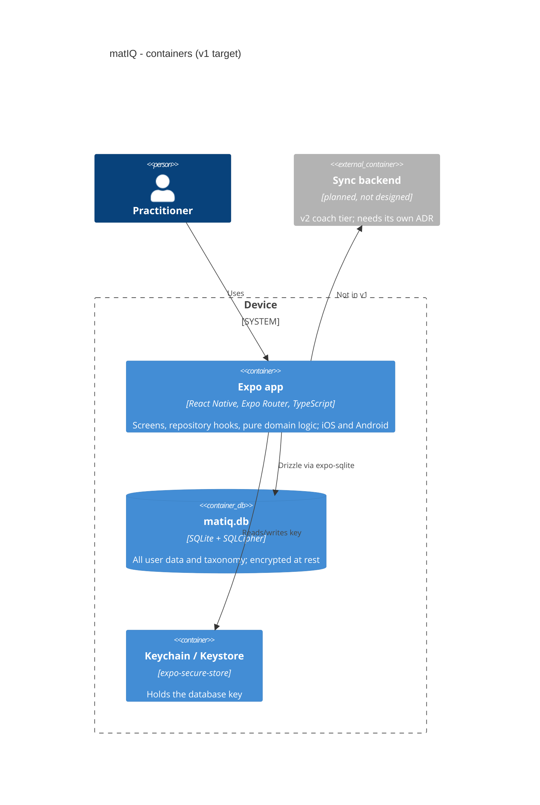

# 05. Building blocks

Target state per `.claude/rules/data.md` and `docs/product-spec/plan.md`; at sprint 0 only `app_meta` and the skeleton exist.

## Layers inside the app

| Layer | Path | Responsibility | Imports |
|---|---|---|---|
| UI | `mobile/app/` (Expo Router), components | screens, tokens, i18n keys, testIDs | repositories and hooks only |
| Repositories | `mobile/src/repositories/` | all reads/writes, live-query hooks, id and clock injection | `db`, `domain` |
| Domain | `mobile/src/domain/` (tests alongside; Jest is the executable spec) | progression, taxonomy ops, planning, errors registry `errors.ts` | nothing impure |
| DB | `mobile/src/db/` (schema, client, `mobile/drizzle/` migrations) | tables and constraints | `drizzle-orm`, `expo-sqlite` |
| Taxonomy pipeline | `scripts/taxonomy/` | build-time conversion to a versioned seed JSON (ADR 0012) | none at runtime |

Contracts: the sprint-level `docs/<sprint-slug>/data-contracts.md` (data-coder). Data model: `docs/data-model/dictionary.md`, `erd.md`, `changelog.md` (generated). Product-level model: `docs/PRODUCT.md` §5, field level `docs/product-spec/plan.md` §4.
