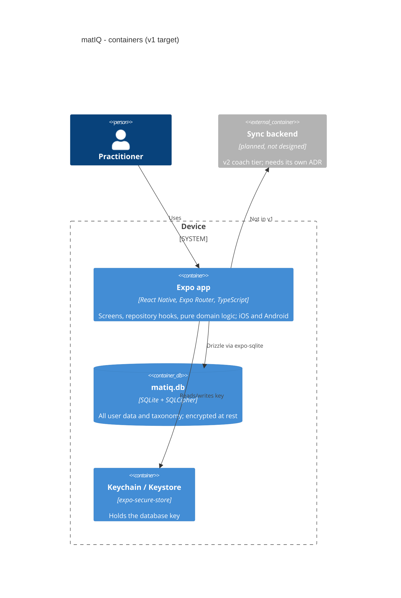
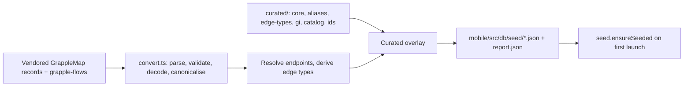

# 05. Building blocks

Target state per `.claude/rules/data.md` and `docs/product-spec/plan.md`. Built so far (sprint 1, `foundation`): the full schema, the encrypted database, the seed pipeline, Log Session, Home and Library. Not built: Settings, Progress, technique detail, export and erase.

## Layers inside the app

| Layer | Path | Responsibility | Imports |
|---|---|---|---|
| Routes | `mobile/app/` (Expo Router: `(tabs)/`, `log-session`, `session/[id]`, `set-rank`, `dev/reset`) | thin route files | features |
| Features | `mobile/src/features/{bootstrap,home,library,log-session,rank,session}/` | screens and feature components, tokens, i18n keys, testIDs | components, hooks |
| Components | `mobile/src/components/` | design-system primitives built from `mobile/src/theme/tokens.ts` | theme |
| Hooks | `mobile/src/hooks/data/` and `mobile/src/repositories/hooks/` | live-query hooks returning `LiveResult<T>`; the only data entry point of the UI | repositories |
| Repositories | `mobile/src/repositories/` | all reads and writes, `db.transaction()` per write, `Db` injected last (ADR 0019) | `db`, `domain` |
| Domain | `mobile/src/domain/` (tests alongside; Jest is the executable spec; see its `README.md`) | session rules, progression, rank, suggestions, taxonomy ops, error registry `errors.ts` | nothing impure |
| DB | `mobile/src/db/` (`schema/`, `open.ts`, `bootstrap.ts`, `client.ts`, `lifecycle.ts`, `key/`, `seed/`) and `mobile/drizzle/` | tables, encryption, key seam, migrations, generated seed JSON | `drizzle-orm`, `expo-sqlite`, `expo-secure-store` |
| Taxonomy pipeline | `scripts/taxonomy/` reading `data/taxonomy/{grapplemap,grapple-flows,curated}/` | build-time conversion to `mobile/src/db/seed/*.json` (ADR 0012, 0021, 0022) | none at runtime |

Contracts: the sprint-level [data-contracts.md](../foundation/data-contracts.md) (data-coder). Data model: [dictionary](../data-model/dictionary.md), [erd](../data-model/erd.md), [changelog](../data-model/changelog.md) (generated). Domain logic: `mobile/src/domain/` and its `__tests__/`. Product-level model: `docs/PRODUCT.md` §5, field level `docs/product-spec/plan.md` §4.

## Taxonomy pipeline

