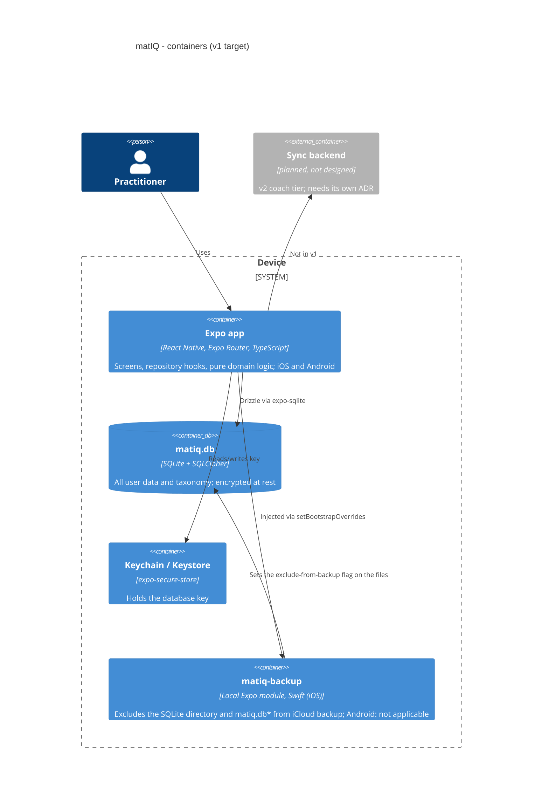
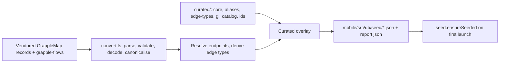
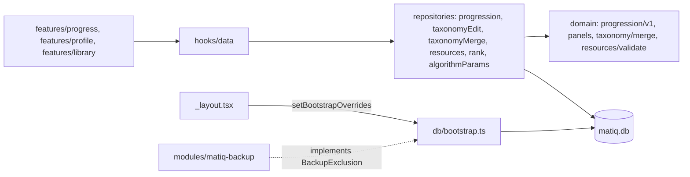

# 05. Building blocks

Target state per `.claude/rules/data.md` and `docs/product-spec/plan.md`. Built so far: sprint 1 (`foundation`) the schema, encrypted database, seed pipeline, Log Session, Home and read-only Library; sprint 2 (`progress-settings`) algorithm v1 and the Progress tab, Profile (Settings), Library editing with merge/undo, Technique detail with Resources, and the iOS backup-exclusion module. Not built: cycles, slots, reminders, export, import, erase (sprint 3).

## Layers inside the app

| Layer | Path | Responsibility | Imports |
|---|---|---|---|
| Routes | `mobile/app/` (Expo Router: `(tabs)/` Home, Library, Log, Progress, Profile; `log-session`, `session/[id]`, `set-rank`, `library-edit`, `resource-edit`, `progress-why`, `dev/reset`) | thin route files | features |
| Features | `mobile/src/features/{bootstrap,home,library,log-session,profile,progress,rank,session}/` | screens and feature components, tokens, i18n keys, testIDs | components, hooks |
| Components | `mobile/src/components/` | design-system primitives built from `mobile/src/theme/tokens.ts` | theme |
| Hooks | `mobile/src/hooks/data/` and `mobile/src/repositories/hooks/` | live-query hooks returning `LiveResult<T>`; the only data entry point of the UI | repositories |
| Repositories | `mobile/src/repositories/` | all reads and writes, `db.transaction()` per write, `Db` injected last (ADR 0019) | `db`, `domain` |
| Domain | `mobile/src/domain/` (tests alongside; Jest is the executable spec; see its `README.md`) | session rules, progression (`progression/v1/`, `progression/panels/`), rank, resources, settings vocabularies, suggestions, taxonomy edit and merge, error registry `errors.ts` | nothing impure |
| DB | `mobile/src/db/` (`schema/`, `open.ts`, `bootstrap.ts`, `backup.ts`, `client.ts`, `lifecycle.ts`, `key/`, `seed/`) and `mobile/drizzle/` | tables, encryption, key seam, migrations, generated seed JSON | `drizzle-orm`, `expo-sqlite`, `expo-secure-store` |
| Taxonomy pipeline | `scripts/taxonomy/` reading `data/taxonomy/{grapplemap,grapple-flows,curated}/` | build-time conversion to `mobile/src/db/seed/*.json` (ADR 0012, 0021, 0022) | none at runtime |

Contracts: the sprint-level [data-contracts.md](../foundation/data-contracts.md) (data-coder). Data model: [dictionary](../data-model/dictionary.md), [erd](../data-model/erd.md), [changelog](../data-model/changelog.md) (generated). Domain logic: `mobile/src/domain/` and its `__tests__/`. Product-level model: `docs/PRODUCT.md` §5, field level `docs/product-spec/plan.md` §4.

## Taxonomy pipeline

## Sprint 2 components (`progress-settings`)

| Component | Path | Role | ADR |
|---|---|---|---|
| Progression v1 | `mobile/src/domain/progression/v1/`, `panels/` | window, signals, state rules, consistency heatmap, planned-vs-actual; pure, no schema | 0024 |
| Progression repository | `mobile/src/repositories/progression.ts` | one `overview` read for Progress and Home suggestions | 0024 |
| Taxonomy editing and merge | `domain/taxonomy/{edit,merge}.ts`, `repositories/taxonomy{Edit,Merge,Rows}.ts` | create, rename, aliases, soft delete, merge with undo | 0025, 0027 |
| Resources | `domain/resources/validate.ts`, `repositories/resources.ts` | manual resources on Technique detail | 0013 |
| Backup seam | `mobile/src/db/backup.ts`, `mobile/modules/matiq-backup/` | `BackupExclusion` interface and its iOS implementation | 0026 |
| Profile and Progress features | `features/profile/`, `features/progress/` | Settings screens, theme override, About, Progress panels and "why" sheet | 0028 |

Contracts: [progress-settings data-contracts.md](../progress-settings/data-contracts.md) (data-coder).
