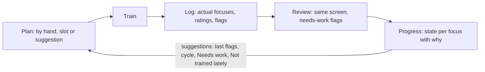

# 06. Runtime view

Sourced from `docs/PRODUCT.md` §4 and §7; screens are specified, not built. Partial.

| Flow | Summary | Source |
|---|---|---|
| Log session | Prefilled type and planned focuses -> rating per focus -> save; completes only with >= 1 actual focus | R-26, plan §5 |
| Progression | Computed on demand when Progress opens or a session is reviewed; no background jobs; reads `algorithm_params` | ADR 0010 |
| Slot generation | Slots create PLANNED sessions 14 days ahead; tombstones prevent resurrection of skipped instances | ADR 0017 |
| Taxonomy release | Upsert only unedited `origin = seed` rows | ADR 0011 |
| Erase-all | Close DB, delete DB + WAL + SHM and key, new key, reseed | ADR 0015 |

Pending: sequence diagrams for startup (key retrieval, `PRAGMA key`, migrations) await sprint 1.
