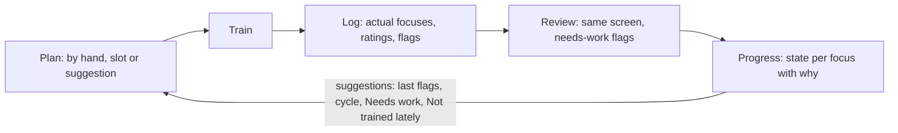
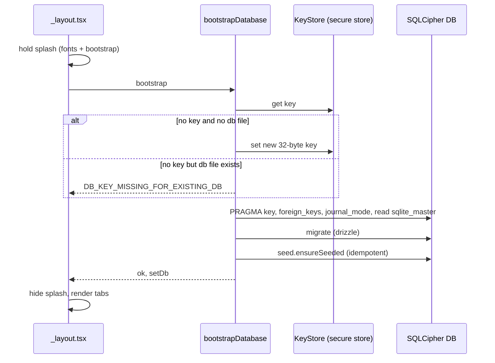

# 06. Runtime view

Core loop from `docs/PRODUCT.md` §4 and §7. Built in sprint 1: startup and the Log Session save; the review-to-progression recompute is not built. Partial.

| Flow | Summary | Source |
|---|---|---|
| Log session | Prefilled type and planned focuses -> rating per focus -> save; completes only with >= 1 actual focus | R-26, plan §5 |
| Progression | Computed on demand when Progress opens or a session is reviewed; no background jobs; reads `algorithm_params` | ADR 0010 |
| Slot generation | Slots create PLANNED sessions 14 days ahead; tombstones prevent resurrection of skipped instances | ADR 0017 |
| Taxonomy release | Upsert only unedited `origin = seed` rows | ADR 0011 |
| Erase-all | Close DB, delete DB + WAL + SHM and key, new key, reseed | ADR 0015 |

## Startup (built, ADR 0019, 0020, 0022)

Any step failing returns a `DB_*` code and the root layout renders the bootstrap error screen; retry re-runs the sequence. Encryption on a device is not yet verified (see 11).

## Log Session save (built)

| Step | Behaviour | Source |
|---|---|---|
| Open | Home quick log or the Log tab resolves `quickLogTarget`: today's planned session if any, else a new log with the type prefilled | ADR 0017, `data-contracts.md` |
| Modes | `log` completes or creates a COMPLETED session; `plan` creates a PLANNED one; `edit` revises, review mode on a COMPLETED session | F-19 |
| Save | `sessions.log` in one transaction: type and at least one actual focus are enough; planned focuses left unticked stay as planned-not-trained rows; techniques, counts and rating only on actual rows | ADR 0018 |
| After | Live hooks re-read on table change; Home shows the session; undo toast reverses a save or delete | R-26 |

Pending: the review to progression recompute (sprint 2) and slot generation (sprint 3).
