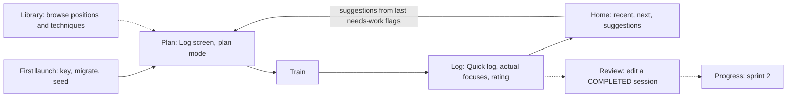

# Requirements: foundation (sprint 1)

Scope of sprint 1 (`docs/foundation/plan.md` §0): first-launch seed and encryption, Log Session, Home, Library read-only. Stories restate behaviour proven by Jest (`docs/foundation/verify.md`: 912 tests at 17ffe6e, tsc clean). **No Maestro flow was run** (INFRA UNAVAILABLE: Maestro and CocoaPods missing), so on-device behaviour, including encryption, is specified but not E2E-verified (`docs/foundation/test-report.md`). Items marked "assumed" rest on `docs/foundation/assumptions.md`, not on a ruling. Fictional data only.



Solid lines are built in sprint 1; dotted ones are partial (review by edit) or later sprints (Progress).

## US-F01 First launch seeds an encrypted database (R-24, R-28, D-07; ADR 0019, 0020, 0022)
As a practitioner, I want the app to set itself up on first launch with my data encrypted, so that I never handle a key and my training data stays private.

```gherkin
Scenario: First launch
  Given the app is installed and has never been opened
  When I open it
  Then the splash stays until fonts and the database are ready
  And the database is created with a generated key held in the device keychain
  And the taxonomy, session types, subjects and default settings are present
  And Home opens without a network call

Scenario: Second launch changes nothing
  Given the app has been opened before
  When I open it again
  Then the seed adds no rows and the taxonomy release is unchanged

Scenario: Database exists but the key is gone
  Given a database file exists and the keychain has no key for it
  When I open the app
  Then I see an error screen titled for the missing key, not an empty app
  And no second empty database is created
```

## US-F02 Log a session in two taps (R-26, R-00, F-19, F-20; NF-01, NF-02; assumed A-7, A-19)
As a practitioner, I want to log a session with prefilled type and planned focuses, so that logging takes 30 seconds or less.

```gherkin
Scenario: Quick log with a planned session today
  Given a PLANNED session exists for today with two planned focuses
  When I tap Quick log on Home
  Then the Log screen opens prefilled with that session's type and focuses
  And Save is available after one actual focus is ticked

Scenario: Minimum valid log
  Given I have chosen a session type
  And I have added one actual focus
  When I save
  Then a COMPLETED session exists with that focus
  And Home lists it under recent sessions

Scenario: Save is disabled with a reason
  Given I have chosen a session type and no actual focus
  Then Save is disabled and the reason is shown

Scenario: Unticked planned focus stays as a gap signal
  Given a planned session with focuses "Closed guard" and "Knee on belly"
  When I log it with only "Closed guard" ticked
  Then "Knee on belly" is kept as planned and not trained
  And it carries no rating, needs-work flag, counts or techniques

Scenario: Rating, needs-work and counts only on trained focuses
  Given a planned focus that is not ticked
  When I try to save a rating, a hit count or a technique on it
  Then the save is refused with the matching error and nothing is stored

Scenario: Undo
  Given I have saved or deleted a session
  When I tap Undo on the toast
  Then the session returns to its previous state
```

## US-F03 Plan a session (R-07, R-09, F-19; assumed A-19)
As a practitioner, I want to plan a session with a type, time and focuses, so that I arrive at the mat with intent.

```gherkin
Scenario: Plan from Home
  Given I have no planned session
  When I use the empty planning card and add two focuses
  Then a PLANNED session exists and Home shows it as the next session

Scenario: Stale plan
  Given a PLANNED session dated before today
  Then Home shows it as stale with "Log it" and "Skip"
  And Skip marks it SKIPPED and can be undone
```

## US-F04 Review a logged session (R-26, F-19)
As a practitioner, I want to reopen a completed session and change ratings, flags and notes, so that my review reflects what I learned later.

```gherkin
Scenario: Edit a COMPLETED session
  Given a COMPLETED session
  When I open it from its detail and edit
  Then the Log screen opens in review mode with the stored values
  And saving keeps the session COMPLETED and replaces the focus rows I changed
```

## US-F05 See what to work on from Home (R-09, R-10, F-22; assumed A-22, A-30)
As a practitioner, I want Home to show recent sessions, the next plan, suggestions and my rank, so that I can decide quickly what to train.

```gherkin
Scenario: Suggestion from the last session
  Given my last completed session flagged "Knee on belly" as needs work
  Then Home offers it as a suggestion labelled with its source
  And no suggestion comes from Progress, which does not exist yet

Scenario: Set rank
  Given no rank is stored
  When I set belt "Blue", 1 stripe and an awarded date
  Then the rank card shows it
```

## US-F06 Browse the library (R-23, R-28, R-34, F-23; assumed A-21)
As a practitioner, I want to browse positions and techniques and search by any name, so that I can find what to focus on.

```gherkin
Scenario: Alias search
  Given the seeded taxonomy
  When I search "knee mount"
  Then "Knee on belly" is listed with the matching alias shown

Scenario: Position detail
  Given I open a position
  Then I see its description, parent and children, and its techniques grouped by type
  And each technique shows from and to positions, a GI or NOGI badge and its perspective

Scenario: Core library by default
  Given the setting "show extended library" is off
  Then only the curated core is listed
  And there is no control to change this in sprint 1

Scenario: No match
  When I search for a string that matches nothing
  Then an empty state with a way to clear the search is shown
```

## Not in this sprint
Settings, Progress, technique detail, cycles and slots UI, detailed rounds UI, export, import and erase (R-32: sprints 2 and 3).
