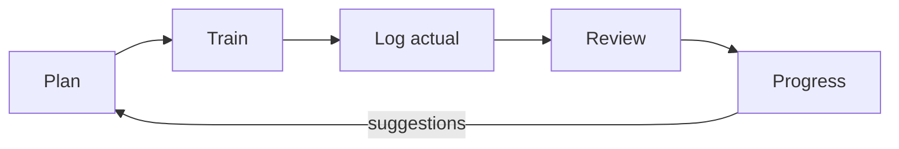

# Requirements: product-spec (core loop)

Sprint 0 is docs-only: these stories restate the specified behaviour (`docs/PRODUCT.md` §4, §6, §7) for the sprints that build it. Nothing here is tested yet. Items marked "assumed" rest on `docs/product-spec/assumptions.md`, not on a ruling. Fictional data only.



## US-01 Plan a session (R-07, R-09, R-20, R-21)
As a practitioner, I want to plan a session with focuses, from suggestions or a weekly slot, so that I do not plan everything by hand.

```gherkin
Scenario: Suggestions respect settings
  Given the suggestion source "Not trained lately" is switched off and the maximum is 3
  When I open the planning flow
  Then suggestions come only from the enabled sources, at most 3, each labelled with its source
  And I can accept or ignore each one

Scenario: A weekly slot generates sessions
  Given a slot on Tuesday 19:00 of type "Gi class"
  When the app generates sessions
  Then planned sessions exist for the next 14 days with the slot's type
  And a skipped instance is not recreated
```

## US-02 Start a log quickly (R-26, R-00; NF-01, NF-02; assumed A-7)
As a practitioner, I want to reach a prefilled Log Session in two taps, so that logging takes 30 seconds or less.

```gherkin
Scenario: Quick log from Home
  Given a planned session today
  When I tap the quick-log action on Home
  Then the Log Session screen opens with its type and planned focuses pre-ticked within 2 taps from Home
  And saving takes one further tap
```

## US-03 Log what I actually trained (R-04, R-05, R-30, R-34; NF-03)
As a practitioner, I want to record the actual focuses with a rating, a needs-work flag, a comment and optional counts, so that the record reflects reality.

```gherkin
Scenario: Minimal log
  Given only a session type and one focus are provided
  When I save
  Then the session is stored as COMPLETED

Scenario: Cannot complete without an actual focus
  Given no actual focus
  When I save as completed
  Then a DomainError is shown with a mapped message and nothing is stored

Scenario: Find a position by any name
  Given a position with the alias "closed guard"
  When I search "closed"
  Then the position appears under its canonical name with its aliases beneath

Scenario: Needs-work flag requires an actual focus
  Given a focus row that was planned but not trained
  Then it cannot carry a needs-work flag or a rating
```

## US-04 Log sparring at the level of detail I want (R-06, R-19; assumed A-1)
As a practitioner, I want aggregates always and detailed rounds optionally, so that I can log one round in detail and the rest globally.

```gherkin
Scenario: Aggregates without detail
  Given detailed rounds are off
  When I enter 5 rounds, 1 submission landed tied to a technique
  Then the session stores the aggregates and the submission without any round row

Scenario: One detailed round
  Given "detailed rounds" is on in Settings
  When I add one round with partner belt and outcome
  Then the round is stored and the remaining rounds stay in the aggregate
```

## US-05 Review the session (R-05, R-26)
As a practitioner, I want to review in the same screen, with session rating, duration, intensity, energy and what worked or failed, so that the review feeds suggestions.

```gherkin
Scenario: Review fills the same session
  Given a completed session
  When I open it in review mode and set rating 4, energy 3 and a note
  Then the values are stored on the session
  And a flagged focus appears as a suggestion in the next planning flow
```

## US-06 See what is improving or lacking (R-08, R-17, R-22; ADR 0010)
As a practitioner, I want a state per focus with the reason, so that I know where to work.

```gherkin
Scenario: No training in the window
  Given a focus never trained or last trained more than staleDays ago
  Then its state is "Not trained lately" and the explanation names the rule

Scenario: Sparse data
  Given a signal lacks enough data
  Then it is omitted, remaining weights are rescaled and the explanation says so

Scenario: Flagged is separate
  Given the latest trained session flagged the focus
  Then a "Flagged" badge is shown alongside, not as a state
```

## US-07 Tune the algorithm (R-08, R-22)
As a practitioner, I want to edit the window, weights and thresholds and reset them, so that the algorithm fits me.

```gherkin
Scenario: Reset to defaults
  Given I changed windowWeeks and a weight
  When I choose "reset to defaults"
  Then every parameter equals its default value and the active version is unchanged
```

## US-08 Edit the library without losing history (R-14, R-23, R-28; assumed A-9)
As a practitioner, I want to rename, hide or merge positions and techniques, so that my Library fits how I train.

```gherkin
Scenario: Rename follows the id
  Given a position used in past sessions
  When I rename it
  Then past sessions show the new name

Scenario: Delete hides but keeps history
  When I delete a position
  Then it disappears from pickers and past sessions still render it
  And an undo toast restores it

Scenario: Merge is undoable
  When I merge position A into B
  Then all references move to B and A is hidden
  And undo from the merge log restores them

Scenario: Re-import never overwrites my edits
  Given I edited a seeded position
  When a taxonomy release is installed
  Then my edited row is unchanged
```

## US-09 Keep my data mine (R-12, R-24, R-27; assumed A-2, A-10)
As a practitioner, I want my data encrypted, exportable, importable and erasable, so that I control it.

```gherkin
Scenario: Export
  When I export
  Then a versioned JSON of every table is offered through the share sheet with a plaintext warning

Scenario: Erase all
  When I hold-to-erase in Settings
  Then the database, its WAL, the key are deleted and a fresh seeded database is created
```

## US-10 Track my rank (R-10)
As a practitioner, I want belt and stripes with promotion dates, so that Home and Progress show my rank and history.

```gherkin
Scenario: Current rank
  Given two rank entries
  Then the latest live entry is the current rank and the history lists both
```

## US-11 Resources (R-29)
As a practitioner, I want to attach a resource to a technique, focus or cycle with a watch status, so that I can find study material.

```gherkin
Scenario: Attach and mark watched
  Given a resource "to watch" attached to a technique
  When I mark it watched
  Then the technique detail shows it as watched
```

## US-12 Reminders (R-11)
As a practitioner, I want optional local reminders before and after sessions, so that I remember to train and log.

```gherkin
Scenario: Off by default
  Given a fresh install
  Then no reminder is scheduled until I enable one in Settings
```
