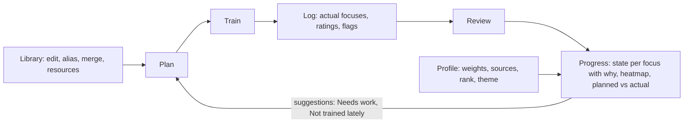

# Requirements: progress-settings (sprint 2)

Scope (`docs/progress-settings/plan.md` §0): algorithm v1 and the Progress tab with rank history, consistency heatmap and planned-vs-actual panel; the Profile tab as Settings; Library editing with aliases and merge/undo; Technique detail with Resources; the iOS backup exclusion; the back-label fix. No schema change (ADR 0024). Rulings: R-52 (Q1), R-53 (Q2), R-54 (Q3), R-55 (Q4), R-56 (Q5), all 2026-11-01 (`docs/decisions.md`, proposed text in `docs/progress-settings/docs-report.md` until the PO's file carries them).

Evidence: Jest 1726 passed at 0e8d4db (`verify.md`); Maestro 13/13 on the iOS simulator dev-client build (`docs/progress-settings/test-report.md`; three flows passed in single-flow runs only). Android is not E2E-verified (CO-03). Fictional data only.



## Story to Maestro flow map

| Story | Flows (`e2e/maestro/flows/`) |
|---|---|
| US-P01 Progress states | `features/progress-states` |
| US-P02 Progress panels | `features/progress-panels` |
| US-P03 Algorithm settings | `features/settings-weights` |
| US-P04 Rank and theme | `features/settings-rank-theme` |
| US-P05 About and backup | `features/settings-about` |
| US-P06 Library editing | `features/library-edit` |
| US-P07 Merge | `features/library-merge` |
| US-P08 Technique resources | `features/technique-resources` |
| US-P09 Back label | `regression/back-label` |

## US-P01 See which focuses improve or lack, and why (R-08, R-17, R-49; PS-02..PS-06; ADR 0024)
As a practitioner, I want each focus classed as Improving, Steady, Needs work or Not trained lately with the reason, so that I know what to plan next.

```gherkin
Scenario: State with explanation
  Given a focus trained in the last 8 weeks with falling ratings and a needs-work flag
  When I open the Progress tab
  Then the focus is listed under Needs work
  And opening its why sheet shows the rule that fired and the signal values

Scenario: Sparse data
  Given a focus with fewer sessions than the minimum
  When I open the Progress tab
  Then no trend is claimed and the sheet says there is not enough data

Scenario: Flagged badge
  Given my most recent completed session flagged the focus as needs work
  Then the row carries a Flagged badge that is not a state

Scenario: Removed taxonomy row
  Given a focus whose position was soft-deleted but was trained inside the window
  Then it is listed under Removed
```

## US-P02 See consistency and planned-versus-actual (R-52, R-15; PS-21..PS-23)
As a practitioner, I want a consistency heatmap, a gap panel and my rank history, so that I see how regularly I train and whether I train what I plan.

```gherkin
Scenario: Heatmap
  Given sessions on several local dates, two of them on the same day
  When I open Progress
  Then each week row (Monday start) shows one cell per day with the session count and minutes
  And meaning is never carried by colour alone

Scenario: Gap panel
  Given a focus planned in three sessions and trained in one
  Then the panel shows the gap for that focus and the totals
  And an unplanned but trained focus is listed as unplanned

Scenario: No sessions
  Given no sessions
  Then each panel shows an empty state naming the next step
```

## US-P03 Tune the algorithm and suggestions (R-08, R-22, R-49; PS-07, PS-08)
As a practitioner, I want to edit the weights, thresholds and window, choose suggestion sources and reset to defaults, so that the algorithm fits how I train.

```gherkin
Scenario: Edit a weight
  Given the algorithm screen
  When I change a weight within its bounds
  Then Progress recomputes with the new value

Scenario: Rejected value
  When I enter a value outside its bounds or a non-integer for the window
  Then the field shows the error and nothing is saved

Scenario: Reset
  When I reset to defaults
  Then every parameter of the active version returns to its default

Scenario: Suggestion sources
  Given the Needs work source is on
  Then Home suggests focuses classed Needs work
```

## US-P04 Rank scale and theme (R-10, R-54, R-56; PS-09..PS-11; ADR 0028)
As a practitioner, I want to set my rank (including the kids scale) and choose light, dark or system theme, so that the app reflects me.

```gherkin
Scenario: Profile layout
  When I open the Profile tab
  Then it is titled "Profile" with rank at the top and settings groups below

Scenario: Kids scale
  Given I switch the rank scale to Kids
  When I set a belt
  Then Save is reachable and the entry is stored on the Kids scale
  And adult entries are hidden, not deleted

Scenario: Theme override
  When I choose Dark
  Then the whole app, headers and sheets included, renders dark
  And choosing System follows the device again
```

## US-P05 About and backup status (R-28, R-39; PS-17, PS-19; ADR 0026)
As a practitioner, I want to see licences and whether my data is kept out of backups, so that I trust where it lives.

```gherkin
Scenario: About
  Given the About screen
  Then each taxonomy source shows its licence, link, credit and change note
  And the app and algorithm versions are shown

Scenario: Backup excluded
  Given an iOS build
  Then the backup line reads "excluded" after launch
  And if exclusion fails, the line says so and the app still opens

Scenario: Android
  Given an Android build
  Then the backup line reads not applicable
```

## US-P06 Edit the library (R-14, R-26, R-50; PS-12, PS-13, PS-24; ADR 0027)
As a practitioner, I want to add, rename and delete positions, techniques and subjects and give them aliases, so that the library speaks my language.

```gherkin
Scenario: Rename keeps the old name
  Given a position "Closed guard"
  When I rename it
  Then the old name becomes an alias and search still finds it

Scenario: Duplicate position name
  When I create a position whose name equals a live one, ignoring case
  Then I see the duplicate error and nothing is saved

Scenario: Same technique name, different edge
  When I create a technique with an existing name from another position
  Then it is saved

Scenario: Soft delete and undo
  When I delete a row
  Then it disappears from lists and pickers, history shows "(removed)"
  And undo restores it
```

## US-P07 Merge duplicates and undo (R-14, R-26; PS-14; ADR 0025)
As a practitioner, I want to merge two rows into one without losing history, and undo it, so that I can clean up duplicates safely.

```gherkin
Scenario: Merge
  Given two positions both used in my sessions
  When I merge one into the other
  Then my sessions, techniques, resources and aliases now point to the survivor
  And the loser's name is an alias of the survivor

Scenario: Folded rows keep attachments
  Given one session logged both positions as focuses
  When I merge them
  Then one focus row remains and the techniques attached to either are attached to it

Scenario: Undo
  When I tap Undo on the toast
  Then both rows and all references are as before

Scenario: Undo no longer allowed
  Given a later merge touched the same row
  Then undoing the earlier merge is refused (MERGE_NOT_LATEST)
```

## US-P08 Resources on a technique (R-29; PS-15, PS-16; ADR 0013)
As a practitioner, I want to attach resources to a technique, mark them to-watch or watched, and see where I trained it, so that study and practice meet.

```gherkin
Scenario: Add a resource
  Given a technique detail
  When I add a title and an http(s) link
  Then it is listed with a to-watch status

Scenario: Invalid link
  When I enter a link that is not http or https
  Then the field shows the error

Scenario: Without link
  When I add a resource with a title only
  Then it is saved

Scenario: History
  Given the technique was attached to sessions or logged as a submission
  Then the newest 20 sessions are listed
```

## US-P09 Back button without a label (CO-42; PS-18)
As a practitioner, I want a back button that shows no stray text, so that headers stay clean.

```gherkin
Scenario: Minimal back
  Given I open a pushed screen from a tab
  Then the back button shows no title text
```

## Not in this sprint
Session-type and resource-type list editors (R-53, sprint 3); coral and red belts (R-55, CO-27); cycles, slots, reminders, export, import, erase, detailed rounds (sprint 3).
